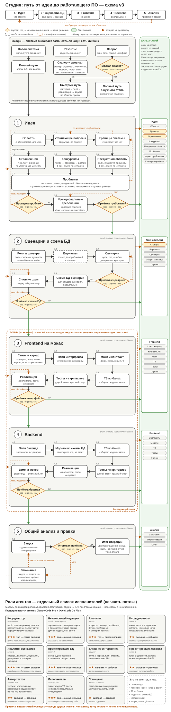

# pacage-studio 8.3 — студия «от идеи до работающего ПО»

Студия ведёт проект от сырой идеи до работающей системы по одной схеме: пять этапов вокруг единого
банка знаний, ворота качества между этапами, AI-агенты с настраиваемыми моделями и карты фронтенда
и бэкенда. Только Windows. Агенты: **Claude Code Pro** и **OpenCode Go Plus**.



*Схема (SVG; та же картинка для браузера — [`docs/pipeline-v3/v3.html`](docs/pipeline-v3/v3.html),
подробности по пунктам решения — остальные файлы в [`docs/pipeline-v3/`](docs/pipeline-v3/README.md)).*

## Заточена под один стек

Бэкенд — **fastbase → core-package → event-infra** (PostgreSQL), фронтенд — **Vue 3, Vite, Pinia, Vue Router**.
Студия строит и проверяет проекты именно на нём: каркас `frontend/` и сценарии/роуты/`models.py` создаёт код,
правила стека входят в каждое ТЗ и в подсказки ролей, а на воротах этапов 3–4 код проверяют сканеры студии
(роут → `run("сценарий")` → модель, слои и правила интерфейса). Подробно — [docs/stack.md](docs/stack.md).

## Как это устроено

* **Три входа.** «Новая система» (полный путь), «Развитие» (сканер читает код, агент восстанавливает
  замысел) и «Запрос» (мелкая правка идёт быстрым путём, остальное — полным с нужного этапа).
* **Пять этапов:** 1 Идея → 2 Сценарии и схема БД → 3 Frontend на моках → 4 Backend → 5 Общий анализ и
  правки. Каждый этап: вход (только принятое из банка) → шаги → ворота → банк. При необходимости этапы
  3–4 повторяются «волнами» по пакетам сценариев.
* **Банк знаний** один на проект (`.studio/bank`), раздел на каждый этап. Шаги пишут «черновик»,
  «принято» запись получает только через ворота. Статусы: черновик → принято → устарело → принято
  (версия N+1); метки: отклонено, «из кода», принято ниже порога.
* **Цепочка «происходит из».** У каждой записи при создании указан родитель (проблема → требование →
  сценарий → страница → вызов API → эндпоинт; критерий → тест). Код проверяет покрытие. То, что «висит»
  или противоречит системе, принять нельзя: его отклоняют или внедряют (привязывают к родителю).
* **Ворота из трёх слоёв.** Проверки кодом (жёсткие) → независимая оценка другой моделью (каждый
  критерий 0–10, каждый не ниже 8, с доказательством; критерии у каждых ворот свои и правятся в
  Настройках, по умолчанию уже заполнены) → решение по режиму участия. Не больше трёх кругов подряд.
* **Режимы участия:** «Вручную», «На воротах» (по умолчанию), «Автопилот». В автопилоте агенты решают
  сами; за человеком остаются итоговая приёмка и случай «агент застрял».
* **Запрос на изменение.** Принятое напрямую не меняется: запрос → этап-владелец → расчёт затронутого по
  связям → решение → новая версия, затронутое получает «устарело» и перепроверяется.
* **Тесты до реализации.** Критерии приёмки пишутся вместе с требованиями; тесты пишет не исполнитель,
  на «красном старте» они обязаны падать, исполнитель их не правит.
* **Роли агентов** (модель каждой выбирается в Настройках студии; в схеме у каждой рекомендация
  «крутости»): Координатор, Независимый оценщик, Аналитик, Исследователь, Аналитик сценариев,
  Проектировщик БД, Дизайнер интерфейса, Проектировщик бэкенда, Автор тестов, Исполнитель, Помощник.
* **Карты** фронтенда и бэкенда (план пунктиром, факт из кода сплошным, цветом статус) и общая «Карта
  системы» — цепочка от проблемы до теста с разрывами.

## Что есть в интерфейсе

Три раздела в шапке:

* **Конвейер** — путь из пяти этапов с шагами и воротами, карты, банк знаний, запросы на изменение и
  настройки конвейера (режим участия, пороги, критерии ворот, модель каждой роли).
* **Система** — карты кода как они есть: обзор, бэкенд (эндпоинты → сценарии → io → модели) и фронтенд
  (страницы и блоки, правила, связи с эндпоинтами). Читают проект по AST, код не меняют.
* **Настройки** — серверы проекта, тесты проекта, откат последней работы студии.

Подробно — [docs/usage.md](docs/usage.md).

## Установка

Только Windows, Python 3.12 или новее. Для агентов нужны установленные и подключённые к подписке CLI
`claude` (Claude Code Pro) и/или `opencode` (OpenCode Go Plus).

```powershell
python -m pip install --upgrade "pacage-studio @ git+https://github.com/senia-glitch/pacage-studio-ide.git"
```

Для карт кода проект должен быть на стеке `fastbase` / `core-package` / `event-infra`:

```powershell
python -m pip install "fastbase[full] @ git+https://github.com/senia-glitch/fastapi-transport.git"
```

`fastbase` ставится и из студии: `studio install-full` (после установки она сама запускает `pip check`).

## Запуск

В корне проекта (или пустой папки — тогда студия начнёт «с нуля»):

```powershell
studio doctor     # проверка источников и окружения (для проектов на стеке fastbase)
studio            # автоскан + интерфейс в браузере
```

Команды: `studio dev`, `studio scan`, `studio list`, `studio test`, `studio doctor`,
`studio install-full`, `studio help` — см. [docs/usage.md](docs/usage.md).

Пакеты стека инициализируют проект своими командами (в корне проекта): `infra init` (event-infra),
`core-init` (core-package), `fb init` (fastbase). В `.env.fastbase` — ключи `FAT_ROUTES_PACKAGE`,
`FAT_CORE_DISCOVER`, `FAT_API_PREFIX`, `STUDIO_MODELS`.

## Что убрано в 8.0

Прежние части студии 7.x заменены схемой v3 и больше не поддерживаются: этап «Идея» на графе идеи,
«План» (доска идей, дорожная карта «агент ↔ человек», автозапуск агента, выбор задач), внешние агенты
через MCP-сервер и права по токенам, ТЗ/проверка ТЗ/синхронизация описаний/отчёт, генератор идей,
создание планов сценариев, цепочка «Продукт → Фронтенд» в OpenCode. Их место — этапы 1–5 конвейера:
агенты теперь запускаются самой студией по ролям, а ТЗ собирается из банка знаний.

## Документация

- [docs/install.md](docs/install.md) — установка, обновление, Windows/PowerShell.
- [docs/usage.md](docs/usage.md) — разделы, команды, что студия хранит в проекте.
- [docs/pipeline-v3/README.md](docs/pipeline-v3/README.md) — схема студии и решения по ней.
- [docs/stack.md](docs/stack.md) — как студия заточена под стек: каркас, правила, проверки.
- [docs/metadata-format.md](docs/metadata-format.md) — описание `.studio/metadata.json`, якорей и связей.
- [docs/troubleshooting.md](docs/troubleshooting.md) — коды диагностик, ошибки конвейера и агентов.
- [docs/SPEC.md](docs/SPEC.md) — краткое устройство пакета.

Разработка: `pip install -e ".[dev]"`, затем `ruff check` и `pytest -m "not integration"`;
интеграционные тесты запускаются отдельно: `pytest -m integration`.
