# Спецификация цепочки «Продукт → Фронтенд»

## Назначение и границы

Цепочка превращает сырую идею в принятый вами фронтенд на моках и зафиксированный контракт данных.
Она заменит текущую цепочку пакета (Цель → Идеи → Разбор → Выбор задач → Реализация → Проверка → Приёмка).

- **Вход:** одна фраза пользователя, задающая предметную область.
- **Выход:** выбранные требования с обоснованиями, журнал решений, принятый фронтенд на моках, контракт
  данных, список требований «без UI».
- **Вне цепочки:** реализация бэкенда (отдельная цепочка «Бэкенд»), нефункциональные требования, деление на
  версии и MVP.
- **Где работает пользователь:** только в интерфейсе студии. Студия запускает роли сама и хранит результаты
  шагов. Пока цепочка не встроена в студию, её роль играет агент-дирижёр `chain` (см. [prototype.md](prototype.md)).

## Принципы

Пять правил задают поведение всех шагов; при конфликте с инструкцией роли побеждают они.

1. **Потребности первыми.** Сырая идея задаёт только область. Продукт формулируется после анализа
   потребностей, конкурентов и норм.
2. **У каждого пункта есть обоснование.** Каждое требование закрывает хотя бы одну потребность и опирается на
   источник со ссылкой. Пункт без потребности лишний, потребность без пункта считается дырой.
3. **Роли независимы.** Критик, ревьюер согласованности и Решающий работают в чистом контексте и видят только
   результаты других ролей, а не ход их работы.
4. **Единый продукт.** Одно понятие называется одинаково везде, у каждой роли пользователя есть путь от входа
   до результата без тупиков.
5. **Фронтенд первым, бэкенд последним.** Принятый фронтенд задаёт контракт данных, по которому потом строится
   бэкенд.

## Обзор шагов

```mermaid
flowchart LR
    S1["1 · Домен<br/>Исследователь"] --> S2["2 · Исследование<br/>Исследователь ×3"]
    S2 --> S3["3 · Карта потребностей<br/>Аналитик"]
    S3 --> S4["4 · Формулировка<br/>Продакт"]
    S4 --> S5["5 · Требования<br/>Аналитик"]
    S5 --> S6["6 · Критика<br/>Критик"]
    S6 --> S7["7 · Согласованность<br/>Ревьюер"]
    S7 --> S8["8 · Выбор требований<br/>вы или Решающий"]
    S8 --> S9["9 · Фронтенд на моках<br/>Фронтенд-разработчик"]
    S9 --> S10["10 · Тест агентом<br/>Тестировщик"]
    S10 -- ошибки --> S9
    S10 --> S11["11 · Тест вами<br/>всегда вручную"]
    S11 -- вернуть --> S9
    S11 -- принять --> B["Цепочка «Бэкенд»<br/>отдельный запуск"]
```

## Шаги подробно

Каждый шаг читает результаты предыдущих и пишет свой артефакт; следующий шаг стартует только после условия
перехода.

| № | Шаг | Роль | Вход | Выход | Переход дальше |
| --- | --- | --- | --- | --- | --- |
| 1 | Домен | Исследователь | сырая идея | область, роли пользователей, направления поиска | подтверждение: вручную или Решающий |
| 2 | Исследование | Исследователь ×3 параллельно | область и роли | потребности и боли, конкуренты и их функции, обязательные нормы; каждый факт со ссылкой | после последнего прогона; факты без ссылки отброшены |
| 3 | Карта потребностей | Аналитик | факты исследования | потребности: чья, частота, острота, насколько закрыта конкурентами | подтверждение: вручную или Решающий |
| 4 | Формулировка продукта | Продакт | карта потребностей, сырая идея | 2-3 варианта: какие потребности закрывает, для кого, отличие от конкурентов, что вне границ | выбор варианта: вручную или Решающий |
| 5 | Требования | Аналитик | выбранная формулировка, карта | пункты «обязательно» и «предлагаем», у каждого польза, потребность, обоснование, пометка «без UI» при необходимости | сразу |
| 6 | Критика | Критик (замечания) + Аналитик (исправления) | требования, карта, исследование | замечания и исправленный список | нет блокирующих замечаний или исчерпан лимит раундов |
| 7 | Ревью согласованности | Ревьюер согласованности + Аналитик | весь список требований, формулировка | замечания по продукту целиком, сквозные пути ролей | нет блокирующих замечаний или исчерпан лимит раундов |
| 8 | Выбор требований | вы или Решающий | итоговый список, замечания шагов 6-7 | выбранные требования, журнал решений | подтверждение выбора |
| 9 | Фронтенд на моках | Фронтенд-разработчик | выбранные требования, сквозные пути | страницы и блоки на моках, контракт данных | сборка проходит |
| 10 | Тест агентом | Тестировщик | фронтенд, сквозные пути | отчёт: пройденные пути, тупики, ошибки | ошибки есть → шаг 9; иначе шаг 11 |
| 11 | Тест вами | вы | фронтенд, чек-лист путей, отчёт шага 10 | «принять» или «вернуть» с замечаниями | «вернуть» → шаг 9; «принять» → контракт зафиксирован |

**Как пункт попадает в «обязательно»:** закрывает базовую потребность роли, есть у большинства конкурентов или
требуется нормой.
**Как пункт попадает в «предлагаем»:** закрывает боль, которую конкуренты закрывают плохо, или даёт новую
ценность.

## Роли (агенты)

Роль — отдельный агент со своим промптом, моделью, правами и чистым контекстом; студия запускает роль на её
шаге и передаёт ей только нужные артефакты.

| Роль | Шаги | Отвечает за | Видит | Пишет |
| --- | --- | --- | --- | --- |
| Исследователь | 1, 2 | границы домена, факты со ссылками | сырую идею, результаты прошлых прогонов | домен, исследование |
| Аналитик | 3, 5, исправления на 6-7 | карту потребностей, требования с обоснованием | исследование, формулировку, замечания | карту потребностей, требования |
| Продакт | 4 | варианты формулировки продукта | карту потребностей, сырую идею, прошлые варианты | варианты формулировки |
| Критик | 6 | качество каждого пункта | требования, карту, исследование | замечания |
| Ревьюер согласованности | 7 | целостность продукта | все требования, формулировку | словарь, сущности, сквозные пути, замечания |
| Решающий | 1, 3, 4, 8 в авто-режиме | однозначные решения с обоснованием | только результаты других ролей | решения, журнал решений |
| Фронтенд-разработчик | 9 | страницы и блоки на моках, контракт данных | выбранные требования, сквозные пути, ваши замечания | код фронтенда, моки, контракт |
| Тестировщик | 10 | проверку сквозных путей | фронтенд, сквозные пути | отчёт о тесте |

Каждой роли в настройках студии назначаются исполнитель (Claude Code или OpenCode), модель и уровень усилий,
как сейчас у ролей «План», «Реализация» и «Контроль».

## Скиллы (методы)

Скилл описывает, как делать работу, и не привязан к роли: роль загружает нужные скиллы на своём шаге.

| Скилл | Папка | Что описывает | Роли |
| --- | --- | --- | --- |
| Форматы | `chain-formats` | общие правила и JSON-форматы артефактов | все |
| Границы домена | `domain-framing` | как из сырой идеи выделить область, роли и направления поиска | Исследователь |
| Поиск потребностей | `needs-research` | где искать боли ролей, как фиксировать факт со ссылкой | Исследователь |
| Анализ конкурентов | `competitor-analysis` | как отобрать 5-8 конкурентов и составить матрицу «функция × конкурент» | Исследователь |
| Поиск норм | `norms-research` | законы и стандарты домена, обязательные для продукта | Исследователь |
| Карта потребностей | `needs-map` | как сводить факты в потребности и ранжировать их | Аналитик |
| Формулировка продукта | `product-statement` | как из карты получить варианты формулировки с границами | Продакт |
| Требование с обоснованием | `justified-requirement` | формат пункта, правила «обязательно» и «предлагаем», пометка «без UI» | Аналитик |
| Чек-лист критики | `critique-checklist` | покрытие потребностей, источники, дубли, выход за границы | Критик |
| Чек-лист согласованности | `consistency-checklist` | словарь, сквозные пути, сущности, паттерны, навигация, противоречия | Ревьюер согласованности |
| Принятие решений | `decision-making` | критерии, разбор спорных случаев, запись в журнал | Решающий |
| Фронтенд на моках | — (следующий этап) | слой моков, контракт данных, правила стека Vue 3 + Pinia + Router + Vite | Фронтенд-разработчик |
| Проверка сквозных путей | — (следующий этап) | прохождение путей ролей в браузере, формат отчёта | Тестировщик |

## Настройки шагов

Порядок шагов фиксирован, новые шаги не добавляются; настраивается только поведение каждого шага.

| Настройка | Шаги | Что делает |
| --- | --- | --- |
| «Ещё» | 2, 4, 6, 7 | один дополнительный прогон |
| «N раз» | 2, 4, 6, 7 | N прогонов подряд с ранней остановкой |
| Вручную / Решающий | 1, 3, 4, 8 | кто принимает решение на шаге |
| Исполнитель, модель, усилия | все шаги с ролью | задаются для роли, а не для шага |

**Повтор «ещё».** Новый прогон получает всё найденное ранее и задание «только новое»: другие источники, другие
углы, другие варианты формулировки.

**Повтор «N раз».** Прогоны идут подряд. Если прогон почти ничего не добавил, остальные отменяются. У каждого
прогона видно, что он добавил.

**Раунды на шагах 6 и 7.** Раунд — это замечания и исправления. Раунды останавливаются, когда не осталось
блокирующих замечаний или исчерпан лимит N.

**Шаг 11 всегда вручную.** Финальный тест фронтенда не передаётся Решающему ни в каком режиме.

## Решающий

В авто-режиме Решающий заменяет ваш выбор на шагах 1, 3, 4 и 8 и всегда принимает однозначное решение; ответ
«не знаю» запрещён.

**Критерии решения**

- острота и частота потребности;
- обязательность: норма домена или функция у большинства конкурентов;
- замечания критика и ревьюера согласованности;
- вписывается ли пункт в продукт целиком и в его границы;
- наличие источника у обоснования.

**Спорный случай** — источники противоречат друг другу, критик расходится с аналитиком или у обоснования слабые
данные. Тогда Решающий:

1. перечитывает источники и при необходимости делает точечный поиск;
2. выписывает плюсы и минусы каждого варианта;
3. принимает одно решение и помечает его как спорное.

**Журнал решений.** Каждая запись содержит: шаг, пункт, решение (принят или отклонён), обоснование, пометку
«спорное». Вы видите журнал и можете переиграть любое решение.

## Ревью согласованности

Критик проверяет пункты по одному, а ревьюер проверяет продукт целиком; его сквозные пути затем становятся
тестами шагов 10 и 11.

| Проверка | Что считается ошибкой |
| --- | --- |
| Единый словарь | одно понятие названо по-разному в разных областях |
| Роли | роль упоминается в требовании, но её нет в формулировке, или наоборот |
| Сквозные пути | роль не может пройти главный сценарий от входа до результата: путь обрывается или ведёт в тупик |
| Общие сущности | одна сущность описана в областях с разными полями или состояниями |
| Единые паттерны | списки, поиск, фильтры, уведомления, ошибки ведут себя по-разному без причины |
| Навигация | на страницу нельзя попасть из других страниц |
| Противоречия | два требования исключают друг друга |

Каждое замечание помечается как блокирующее или нет. Блокирующие замечания возвращают исправление аналитику в
следующем раунде.

## Фронтенд на моках

Фронтенд строится и проверяется без бэкенда; принятый вами фронтенд фиксирует контракт данных для цепочки
«Бэкенд».

**Контракт данных.** Каждая страница и блок объявляют не только `calls` («METHOD /path»), но и форму данных:
какие поля получают и отправляют. Контракт хранится в студии рядом с метаданными фронтенда.

**Моки.** Слой API фронтенда отвечает данными из моков, построенных по контракту. После готовности бэкенда этот
слой переключается на реальные запросы без правки страниц.

**Тест агентом (шаг 10).** Тестировщик проходит в браузере сквозные пути каждой роли из шага 7 и запускает
Vitest на блоки. Отчёт: пройденные пути, тупики, ошибки.

**Тест вами (шаг 11).** Вы идёте по тем же путям как по чек-листу и оцениваете внешний вид. «Вернуть» отправляет
замечания на шаг 9; «Принять» фиксирует контракт.

**Изменение после приёмки.** Если вы снова правите фронтенд и меняете форму данных, студия показывает разницу
контрактов, чтобы доработать бэкенд.

## Граница с цепочкой «Бэкенд»

Бэкенд — отдельная цепочка, которую вы запускаете после шага 11; её устройство обсуждается позже.

- **Передаётся в неё:** зафиксированный контракт данных, требования с пометкой «без UI» (уведомления, фоновые
  задачи, права, интеграции), журнал решений.
- **Не передаётся:** ход работы ролей первой цепочки; бэкенд опирается только на артефакты.

## Открытые вопросы

- [x] Форматы данных: JSON-схемы артефактов всех шагов — [formats.md](formats.md).
- [ ] Сколько фактов и конкурентов считать достаточным на шаге 2 для ранней остановки.
- [ ] Что делать с существующими проектами и их `ideas.json` при замене старой цепочки.
- [ ] Инструмент браузерного теста для шага 10 (сейчас в студии есть pytest и Vitest).
